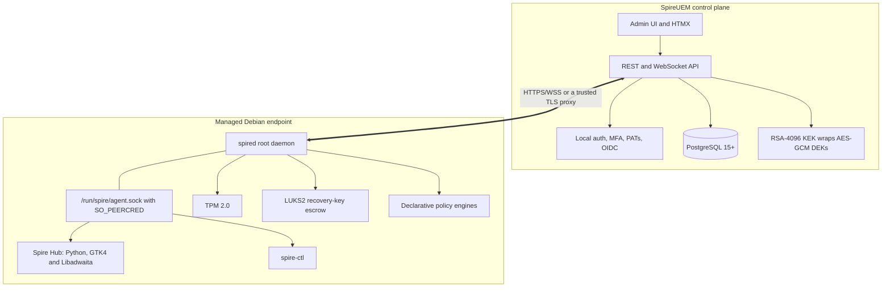

# SpireUEM: Unified Endpoint Management for Enterprise Linux

[](https://github.com/graynetwork/spire-uem/actions/workflows/security-review.yml)
[](LICENSE)
[](docs/BARE_METAL_RUNBOOK.md)

SpireUEM is a self-hosted UEM control plane and endpoint agent for Debian workstation fleets. It combines declarative operating-system policy, software delivery, TPM-backed attestation evidence, LUKS2 recovery-key escrow, vulnerability matching, alerting, and a user-facing desktop software catalog.

## Architecture



- **`spire-server`** hosts the API, WebSocket gateway, admin console, migration runner, alert workers, CVE importer, and cryptographic escrow.
- **`spired`** is a static Go daemon that runs as root and reconciles assigned policy.
- **Spire Hub** is an unprivileged GTK4/Libadwaita application implemented in Python and launched by a small Go wrapper. The Debian package installs Python and GI dependencies.
- **`spire-ctl`** exposes local status, catalog, install, uninstall, and immediate-sync operations through the authenticated UNIX socket.

## Security boundaries

### TPM attestation

The agent performs TPM2 credential activation and submits a fresh AK-signed quote over SHA-256 PCRs 0, 2, 4, and 7. The server validates the EK certificate against configured manufacturer roots, verifies the quote signature and nonce, and derives Secure Boot evidence from signed PCR 7.

SpireUEM maintains administrator-approved PCR baselines and compares each verified quote against the active in-scope baseline: a match reads `BASELINE_MATCH`, a verified quote with no matching baseline reads `BASELINE_MISMATCH` (recording the differing PCRs and alerting), and a device with no in-scope baseline stays `ATTESTED`. A trust decision combines the latest result, a configurable max age, and optional time-boxed per-device exceptions. Attestation enforcement (`off` | `warn` | `enforce`, default `off`) can withhold sealed network-profile secrets from untrusted devices; in `enforce`, affected policies are delivered with an explicit withheld marker and the agent skips them rather than writing a blank credential. A baseline encodes a trusted snapshot of PCR values, not an independent semantic verification of firmware or boot measurements. See [ARCHITECTURE.md §4](docs/ARCHITECTURE.md) and [ADMIN_RUNBOOK.md §15](docs/ADMIN_RUNBOOK.md).

### LUKS2 recovery-key escrow

The agent generates a recovery key in memory and adds it to LUKS2 Keyslot 1 using `/etc/spire/luks-master.key`. It encrypts the key with an ephemeral AES-256-GCM DEK and wraps that DEK with the server's RSA-4096 OAEP-SHA256 KEK.

A `SECURITY_ADMIN` or `SUPER_ADMIN` can reveal a recovery key with a mandatory reason. The reveal is recorded in PostgreSQL and forwarded as RFC 5424 syslog, and it queues automatic key rotation. Recovery-key reveal is not a two-person operation. Crypto-erase wipe is separate and requires two different `SUPER_ADMIN` users.

### Transport

The server accepts one of four explicit deployment modes:

- built-in TLS 1.2 or later;
- a trusted TLS-terminating proxy;
- loopback-only HTTP for local development;
- explicit insecure HTTP for a lab.

The server and bootstrap refuse reachable plain HTTP unless the lab-only override is set. See [TLS deployment](docs/ADMIN_RUNBOOK.md#4-tls-is-required).

### Device certificates and mutual TLS

An internal ECDSA P-256 device CA issues a client-auth leaf to each device at token claim: the agent generates its key locally (never transmitted), sends a CSR, and the server issues a leaf bound to `spire://device/<device-id>` whose serial, fingerprint and validity are stored. `SPIRE_DEVICE_MTLS` sets the mode — `off`, `optional` (default; validate a presented cert, allow none), or `required` (device REST/WebSocket endpoints refuse any request without a valid cert matching the bearer token). Every presented certificate is checked against the database (known serial, not revoked, in validity, device matches the token); revoking a device revokes all its certificates. The agent renews at ~2/3 of the lifetime. `required` cannot be combined with a trusted TLS proxy. Agents may pin the control-plane with `server_ca_file` / `server_ca_sha256`. See [Device certificates and mutual TLS](docs/ADMIN_RUNBOOK.md#4-device-certificates-and-mutual-tls-mtls).

## Features

- Declarative package, Flatpak, systemd, sysctl, APT, dconf, nftables, local-account, CA-certificate, NetworkManager, usbguard, and auditd policy engines.
- Automated endpoint enrollment with hashed, rotatable enrollment tokens: per-token deployment ring, tags, max uses, expiry, optional require-approval and allowed-hostname pattern; one-request registration binding hardware UUID, enrollment key and device CSR; per-token enrollment history and per-IP rate limiting on failed attempts.
- Reusable, immutably-versioned scripts (bash or python3 only) run on endpoints as root or the active user with sha256 verification, environment-only parameters, a per-script timeout and output cap, and sealed secret parameters; custom sensors that run a script version on a schedule and store a typed result as a device attribute; and a `SCRIPT_POLICY` desired-state type (detect / remediate / optional remove).
- Required and optional application assignment through Spire Hub.
- OpenSCAP execution and selected one-click remediation mappings.
- Debian Security Tracker CVE matching. Automatic feed import is off by default.
- Rich hardware, software, network, and security inventory collected by the agent (at most once per `inventory_interval`, default 6h; forced on first check-in after start and on admin request). Scalar facts are stored as typed device attributes; packages, kernel modules, listening sockets, local accounts, CA certificates, and USB devices are stored in dedicated tables replaced per report. Field-level change history (added/removed/modified), a tag-scoped fleet inventory search page, and tag-scoped CSV/JSON export. An old agent reports nothing and the device shows "no inventory reported".
- Device version reporting, minimum-version enforcement, and maintenance-window self-update with size and SHA-256 verification, an independent Ed25519 release-signature check (signing key held off the control plane, public keys pinned in the agent package; required by default), and automatic rollback to the previous package when a new agent fails to confirm healthy.
- TOTP MFA, recovery codes, scoped personal access tokens, local accounts, and OIDC with PKCE.
- Signed webhooks, Slack-compatible webhooks, SMTP alerts, and RFC 5424 syslog forwarding.
- Root PTY sessions, queued commands, attended remote assistance, session lock, lost mode, recovery-key rotation, and two-person signed wipe orders.
- Multi-instance migration coordination and asynchronous device-frame routing. Interactive PTY and remote-assistance streams require the admin and device connection on the same instance.
- Tag-scoped `OPERATOR` and `SECURITY_ADMIN` accounts, including filtered dashboard, vulnerability, and audit views.
- Dynamic device groups and saved fleet queries: a JSON rule over device fields, attributes and CVE state, plus static include/exclude lists, materialised into a membership table and recomputed on check-in, on save, and periodically. Policies and applications can target groups (targeting is the existing tag/ring rules AND membership of a listed group; a policy with no groups behaves exactly as before). Membership changes drive assignment and revoke at the next check-in. Tag scoping applies: a scoped admin's groups carry an implicit tag filter and they cannot edit another scope's groups. A group's rule-evaluation failure keeps the last materialised membership rather than emptying the group.

## Quickstart: test stack

Requirements: Go 1.26+, Docker with Compose, `nfpm`, and `psql` for the full test harness.

```bash
git clone https://github.com/graynetwork/spire-uem.git
cd spire-uem
docker compose -f docker-compose.test.yml up -d --build
```

The test-only control plane is available at `http://localhost:18080/admin`:

- username: `admin`
- password: `SPIRE_ADMIN_PASSWORD`, defaulting to `spire-e2e-breakglass-pw` in the test Compose file

The test stack enables insecure HTTP, simulated TPM support, and an unauthenticated test callback. Never copy those settings into production. Follow [the production runbook](docs/ADMIN_RUNBOOK.md) for a real deployment.

## Enroll the standard agent

Set **Settings → General → server base URL** to the public HTTPS address first. On a Debian endpoint:

```bash
curl -fsSLo /tmp/spire-install.sh https://spire.example.com/install.sh
sudo bash /tmp/spire-install.sh --server-url https://spire.example.com
```

The standard agent generates an enrollment key, stages itself as `PENDING_APPROVAL`, and waits for an administrator to approve it. It stores the resulting bearer token at `/etc/spire/token`.

### Automated enrollment with a token

To onboard without manual approval, pass an enrollment token. The bootstrap writes it to a root-only `0600` file (never into `config.yaml`) and `spired` registers in one request that binds the hardware UUID, the agent's enrollment key, and a CSR for its device certificate:

```bash
sudo bash /tmp/spire-install.sh --server-url https://spire.example.com \
  --enrollment-token-file /root/spire-token   # preferred: file is 0600 and consumed once
# or, visible in the process list / shell history (a warning is printed):
sudo bash /tmp/spire-install.sh --server-url https://spire.example.com \
  --enrollment-token spire_tok_xxx
```

`spired` reads the token from, in order: `enrollment_token_file` (read once, then **deleted on success**), the `SPIRE_ENROLLMENT_TOKEN` environment variable, or the `enrollment_token` config value. A token with `require_approval=false` (the default) auto-approves the device and the bearer token is issued immediately; a `require_approval=true` token stages the device `PENDING_APPROVAL` and the agent polls until an administrator approves it. Without a token the manual approval flow is unchanged.

A token can never let a second machine take over an existing device record: the device is bound to the agent's enrollment key on first registration, and a different machine presenting the same hardware UUID with a different key is refused.

Create and manage tokens under **Settings → Enrollment Tokens** (SUPER_ADMIN). Valid deployment-ring values are `CANARY`, `BETA`, `PILOT`, and `PRODUCTION`; normal device-ring administration uses `CANARY`, `PILOT`, and `PRODUCTION`.

## Verification

Run the containerized integration suite:

```bash
./scripts/test_e2e.sh
```

The suite builds the binaries and Debian package, creates a fresh PostgreSQL database, applies migrations, and exercises authentication, CSRF, device approval, tag scoping, policy reconciliation, TPM simulation, LUKS escrow, application delivery, OpenSCAP, WebSockets, PTY, remote assistance, alerts, CVE matching, and migration behavior.

For physical TPM and LUKS qualification, use [the bare-metal runbook](docs/BARE_METAL_RUNBOOK.md) and [`scripts/test_baremetal.sh`](scripts/test_baremetal.sh).

## Documentation

- [Architecture and security boundaries](docs/ARCHITECTURE.md)
- [Administrator guide](docs/ADMIN_GUIDE.md)
- [Production operations runbook](docs/ADMIN_RUNBOOK.md)
- [Spire Hub and local troubleshooting](docs/DESKTOP_CLIENT_GUIDE.md)
- [Bare-metal qualification](docs/BARE_METAL_RUNBOOK.md)
- [Dated competitive comparison](docs/COMPETITIVE_ANALYSIS.md)

## License

Licensed under the [Apache License 2.0](LICENSE).
