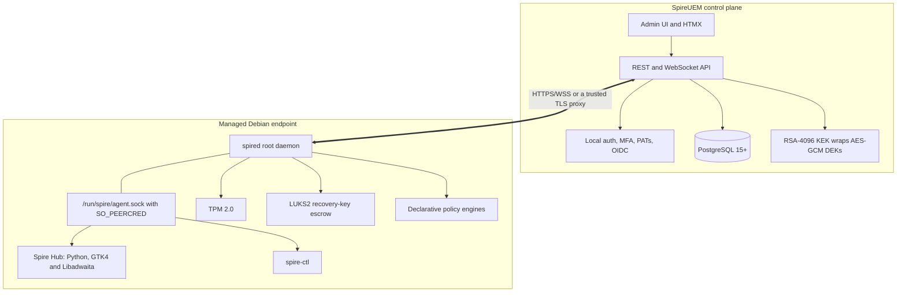

# SpireUEM: Unified Endpoint Management for Enterprise Linux

[](https://github.com/graynetwork/spire-uem/actions/workflows/security-review.yml)
[](LICENSE)
[](docs/BARE_METAL_RUNBOOK.md)

SpireUEM is a self-hosted UEM control plane and endpoint agent for Debian workstation fleets. It combines declarative operating-system policy, software delivery, TPM-backed attestation evidence, LUKS2 recovery-key escrow, vulnerability matching, alerting, and a user-facing desktop software catalog.

## Architecture



- **`spire-server`** hosts the API, WebSocket gateway, admin console, migration runner, alert workers, CVE importer, and cryptographic escrow.
- **`spired`** is a static Go daemon that runs as root and reconciles assigned policy.
- **Spire Hub** is an unprivileged GTK4/Libadwaita application implemented in Python and launched by a small Go wrapper. The Debian package installs Python and GI dependencies.
- **`spire-ctl`** exposes local status, catalog, install, uninstall, and immediate-sync operations through the authenticated UNIX socket.

## Security boundaries

### TPM attestation

The agent performs TPM2 credential activation and submits a fresh AK-signed quote over SHA-256 PCRs 0, 2, 4, and 7. The server validates the EK certificate against configured manufacturer roots, verifies the quote signature and nonce, and derives Secure Boot evidence from signed PCR 7.

SpireUEM currently stores the latest verified PCR values; it does **not** compare them with an administrator-approved PCR baseline. An `ATTESTED` result proves quote authenticity, freshness, and nonzero PCR 7, not that firmware and boot measurements match a known-good value. Attestation status also does not currently gate delivery of assigned policy payloads.

### LUKS2 recovery-key escrow

The agent generates a recovery key in memory and adds it to LUKS2 Keyslot 1 using `/etc/spire/luks-master.key`. It encrypts the key with an ephemeral AES-256-GCM DEK and wraps that DEK with the server's RSA-4096 OAEP-SHA256 KEK.

A `SECURITY_ADMIN` or `SUPER_ADMIN` can reveal a recovery key with a mandatory reason. The reveal is recorded in PostgreSQL and forwarded as RFC 5424 syslog, and it queues automatic key rotation. Recovery-key reveal is not a two-person operation. Crypto-erase wipe is separate and requires two different `SUPER_ADMIN` users.

### Transport

The server accepts one of four explicit deployment modes:

- built-in TLS 1.2 or later;
- a trusted TLS-terminating proxy;
- loopback-only HTTP for local development;
- explicit insecure HTTP for a lab.

The server and bootstrap refuse reachable plain HTTP unless the lab-only override is set. See [TLS deployment](docs/ADMIN_RUNBOOK.md#4-tls-is-required).

## Features

- Declarative package, Flatpak, systemd, sysctl, APT, dconf, nftables, local-account, CA-certificate, NetworkManager, usbguard, and auditd policy engines.
- Required and optional application assignment through Spire Hub.
- OpenSCAP execution and selected one-click remediation mappings.
- Debian Security Tracker CVE matching. Automatic feed import is off by default.
- Device version reporting, minimum-version enforcement, and maintenance-window self-update with size and SHA-256 verification. Update packages are not independently signed by this mechanism.
- TOTP MFA, recovery codes, scoped personal access tokens, local accounts, and OIDC with PKCE.
- Signed webhooks, Slack-compatible webhooks, SMTP alerts, and RFC 5424 syslog forwarding.
- Root PTY sessions, queued commands, attended remote assistance, session lock, lost mode, recovery-key rotation, and two-person signed wipe orders.
- Multi-instance migration coordination and asynchronous device-frame routing. Interactive PTY and remote-assistance streams require the admin and device connection on the same instance.
- Tag-scoped `OPERATOR` and `SECURITY_ADMIN` accounts, including filtered dashboard, vulnerability, and audit views.

## Quickstart: test stack

Requirements: Go 1.26+, Docker with Compose, `nfpm`, and `psql` for the full test harness.

```bash
git clone https://github.com/graynetwork/spire-uem.git
cd spire-uem
docker compose -f docker-compose.test.yml up -d --build
```

The test-only control plane is available at `http://localhost:18080/admin`:

- username: `admin`
- password: `SPIRE_ADMIN_PASSWORD`, defaulting to `spire-e2e-breakglass-pw` in the test Compose file

The test stack enables insecure HTTP, simulated TPM support, and an unauthenticated test callback. Never copy those settings into production. Follow [the production runbook](docs/ADMIN_RUNBOOK.md) for a real deployment.

## Enroll the standard agent

Set **Settings → General → server base URL** to the public HTTPS address first. On a Debian endpoint:

```bash
curl -fsSLo /tmp/spire-install.sh https://spire.example.com/install.sh
sudo bash /tmp/spire-install.sh --server-url https://spire.example.com
```

The standard agent generates an enrollment key, stages itself as `PENDING_APPROVAL`, and waits for an administrator to approve it. It stores the resulting bearer token at `/etc/spire/token`.

Dynamic `spire_tok_...` enrollment tokens are used through `POST /api/v1/enrollment/register` by provisioning clients. The current bootstrap does not accept `--token`, and `spired` does not call that endpoint itself. Valid deployment-ring values are `CANARY`, `BETA`, `PILOT`, and `PRODUCTION`; normal device-ring administration uses `CANARY`, `PILOT`, and `PRODUCTION`.

## Verification

Run the containerized integration suite:

```bash
./scripts/test_e2e.sh
```

The suite builds the binaries and Debian package, creates a fresh PostgreSQL database, applies migrations, and exercises authentication, CSRF, device approval, tag scoping, policy reconciliation, TPM simulation, LUKS escrow, application delivery, OpenSCAP, WebSockets, PTY, remote assistance, alerts, CVE matching, and migration behavior.

For physical TPM and LUKS qualification, use [the bare-metal runbook](docs/BARE_METAL_RUNBOOK.md) and [`scripts/test_baremetal.sh`](scripts/test_baremetal.sh).

## Documentation

- [Architecture and security boundaries](docs/ARCHITECTURE.md)
- [Administrator guide](docs/ADMIN_GUIDE.md)
- [Production operations runbook](docs/ADMIN_RUNBOOK.md)
- [Spire Hub and local troubleshooting](docs/DESKTOP_CLIENT_GUIDE.md)
- [Bare-metal qualification](docs/BARE_METAL_RUNBOOK.md)
- [Dated competitive comparison](docs/COMPETITIVE_ANALYSIS.md)

## License

Licensed under the [Apache License 2.0](LICENSE).
