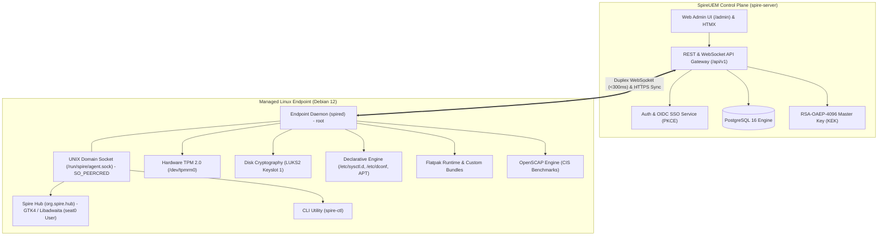

# SpireUEM: Unified Endpoint Management for Enterprise Linux

[]()
[]()
[]()
[]()
[]()

**SpireUEM** is an enterprise-grade, zero-trust Unified Endpoint Management (UEM) control plane and client agent engineered specifically for Debian workstation fleets. It bridges the critical divide between immutable cryptographic hardware integrity, declarative OS baseline enforcement, and user-centric desktop application delivery.

---

## Architecture Overview

SpireUEM decouples administrative orchestration from client execution through an asynchronous, event-driven gateway hub and an unprivileged desktop IPC bridge.



### Component Breakdown
- **Control Plane (`spire-server`)**: Central orchestrator hosting the REST API, duplex WebSocket hub (`/api/v1/desktop/stream`), admin console, and cryptographic key escrow.
- **System Agent (`spired`)**: High-performance Go daemon running as `root` with minimal memory footprint (<25 MB RSS), evaluating declarative policy, executing attestation ceremonies, and enforcing disk encryption escrow.
- **Desktop UI (`Spire Hub` / `org.spire.hub`)**: Modern GTK4 + Libadwaita desktop portal executing unprivileged within the active `seat0` graphical session, communicating with `spired` over an authenticated UNIX domain socket (`/run/spire/agent.sock`).
- **CLI Utility (`spire-ctl`)**: Lightweight operator tool for local diagnostics, policy reconciliation triggers, and hardware attestation inspection.

---

## Key Feature Highlights

### 1. Zero-Trust Hardware Attestation
- **TPM 2.0 Challenge-Response**: Real-time validation of PCR bank integrity (PCR 0 firmware, PCR 2 option ROMs, PCR 4 bootloader, PCR 7 Secure Boot policy) using Endorsement Keys (EK) and Attestation Keys (AK).
- **Cryptographic Quote Verification**: Cryptographically checks TPM signatures against server-generated random nonces; fails closed when tampering or drift is detected.

### 2. Cryptographic Storage Escrow
- **Automated LUKS2 Escrow**: Discovers root and data encrypted block devices, auto-enrolls an ephemeral recovery passphrase into LUKS2 Keyslot 1 without persisting plaintext to disk.
- **RSA-OAEP-4096 Envelope Encryption**: Encrypts recovery payloads client-side using the server's public Key Encryption Key (KEK).
- **Dual-Control Audited Reveal**: Keys are decrypted on-demand with mandatory reason codes, full SIEM RFC 5424 syslog dispatch, and database audit logs.

### 3. Declarative OS Baselines
- **Kernel Tuning**: Atomic `/etc/sysctl.d/20-spire-*.conf` generation with live `sysctl -w` enforcement and rollback cleanup on policy revocation.
- **GNOME Desktop Lockdown**: Declarative `/etc/dconf/db/local.d/` generation with `/etc/dconf/db/local.d/locks/` to strictly enforce screen lock timeouts, privacy masking, and login banners while locking settings against user override.
- **APT Package Lifecycle**: Enforces mandatory package presence or absolute absence across fleet rings.

### 4. Partitioned Application Lifecycle
- **Dual Catalog Paradigm**:
  - `REQUIRED`: Non-optional enterprise software automatically installed and locked against removal.
  - `AVAILABLE`: Self-service catalog published to Spire Hub for on-demand user installation.
- **Multi-Distribution Delivery**: Orchestrates native Debian APT repositories, curated Flathub applications, and air-gapped custom `.flatpak` bundle uploads with SHA-256 verification.

### 5. Continuous CIS Benchmark Compliance
- **Integrated OpenSCAP Engine**: Performs automated, non-disruptive CIS benchmark evaluations against Debian 12 datastreams.
- **One-Click Auto-Remediation**: HTMX-driven administrative interface to transform failed compliance rules into live `SYSCTL_SETTING` policies instantly.

### 6. Identity & Governance (RBAC & OIDC)
- **Role-Based Access Control**:
  - `SUPER_ADMIN`: Full system authority, global settings, cryptographic baseline configuration, and user provisioning.
  - `SECURITY_ADMIN`: Policy authoring, application cataloging, CIS scans, and LUKS recovery reveal.
  - `OPERATOR`: Fleet telemetry, device synchronization, reboot triggers, and remote diagnostics.
  - `AUDITOR`: Read-only access to devices, policies, and compliance export reports.
- **Enterprise SSO**: OpenID Connect (OIDC) authentication with RFC 7636 PKCE (`S256`), dynamic IdP group-to-role mappings, and Just-In-Time (JIT) administrative user provisioning.

### 7. Real-Time Remote Assistance & Diagnostics
- **Sub-Second Live Push**: Duplex WebSocket streaming (<300ms round-trip latency) for instantaneous check-in and patch run triggers.
- **Browser-Based PTY Terminal**: Full VT100/ANSI interactive diagnostic shell powered by `xterm.js` and server-mediated pseudoterminal multiplexing.
- **Attended Remote Assistance**: Desktop user prompt via Spire Hub requiring explicit user confirmation before administrative screen assistance commences.

---

## Quickstart Guide

### Prerequisites
- **Control Plane**: Go 1.22+, Docker & Docker Compose, PostgreSQL 16+
- **Client Systems**: Debian 12 (Bookworm) with Flatpak and OpenSCAP (`libopenscap8`, `ssg-debian12`)

### 1. Launch Control Plane via Docker Compose
Clone the repository and spin up the production test stack:
```bash
git clone https://github.com/graynetwork/spire-uem.git
cd spire-uem

# Launch PostgreSQL 16 and SpireUEM Control Plane
docker compose -f docker-compose.test.yml up -d --build
```
The administrative control plane is now live at `http://localhost:18080/admin`.
- Default Username: `admin`
- Default Password: `changeme`

### 2. Generate Enrollment Token
Log into the SpireUEM web console, navigate to **Settings** $\rightarrow$ **Enrollment Tokens**, and click **Generate Token**, or use the API:
```bash
curl -s -u admin:changeme -X POST http://localhost:18080/admin/settings/tokens \
  -H "Content-Type: application/json" \
  -d '{"description":"Workstation Ring Token","target_ring":"GENERAL","max_uses":50}'
```

### 3. Enroll a Linux Endpoint
On the target Debian endpoint, run the single-command zero-touch bootstrap:
```bash
curl -sSL http://<spire-server>:18080/install.sh | sudo bash -s -- \
  --server http://<spire-server>:18080 \
  --token <ENROLLMENT_TOKEN>
```
The agent automatically registers hardware UUID, extracts TPM capabilities, initializes `/run/spire/agent.sock`, and connects the duplex WebSocket stream.

---

## Verification & Test Harness

SpireUEM includes an end-to-end integration and qualification suite:

```bash
# Run complete 38-step containerized integration test suite
./scripts/test_e2e.sh
```

### Test Harness Coverage:
1. Binary compilation and `.deb` package generation via `nfpm`.
2. Secure cookie session validation, CSRF middleware enforcement, and HTTP headers (`nosniff`, `DENY`).
3. Operations dashboard real-time ribbon metrics and Chart.js feeds.
4. Device approval, tag targeting (`laptop` vs `kiosk`), and patch ring assignment (`ALPHA`, `BETA`, `GENERAL`).
5. TPM 2.0 challenge-response attestation and fail-closed simulation verification.
6. LUKS2 envelope escrow, RSA-OAEP decrypt verification, and audited recovery key reveal.
7. Declarative DConf profile, keyfile locking, and GNOME wallpaper distribution.
8. Sysctl kernel parameter enforcement (`/etc/sysctl.d/`) and dynamic rollback on policy deletion.
9. APT package management and automated background unattended-upgrades verification.
10. Partitioned application delivery: required system Flatpak bundles vs user-managed self-service catalog.
11. Full CIS benchmark compliance scanning and one-click auto-remediation.
12. WebSocket push latency and live interactive PTY terminal streaming.
13. Attended remote assistance authorization protocol.
14. System settings persistence, SIEM RFC 5424 syslog event dispatch, and dynamic token lifecycle.
15. Enterprise RBAC role hierarchy enforcement and OIDC claim group resolution with JIT user provisioning.

For physical bare-metal hardware qualification, see [`docs/BARE_METAL_RUNBOOK.md`](docs/BARE_METAL_RUNBOOK.md) and [`scripts/test_baremetal.sh`](scripts/test_baremetal.sh).

---

## Documentation Index

- **[System Architecture & Threat Model](docs/ARCHITECTURE.md)**: Deep dive into IPC socket permissions (`SO_PEERCRED`), mutual TLS, TPM quotes, and LUKS2 escrow design.
- **[Administrator Operations Guide](docs/ADMIN_GUIDE.md)**: Production manual for policies, application deployment, OIDC SSO integration, and audit compliance.
- **[Desktop Client & Spire Hub Manual](docs/DESKTOP_CLIENT_GUIDE.md)**: IT support and user handbook for the GTK4 client application.
- **[Bare-Metal Hardware Runbook](docs/BARE_METAL_RUNBOOK.md)**: Qualification procedures for physical TPM 2.0 chips, Secure Boot, and LUKS installations.
- **[Enterprise Competitive Analysis](docs/COMPETITIVE_ANALYSIS.md)**: In-depth technical comparison against Microsoft Intune, Canonical Landscape, and Chef/Ansible.

---

## License

SpireUEM is distributed under the Apache License 2.0. See [`LICENSE`](LICENSE) for details.
